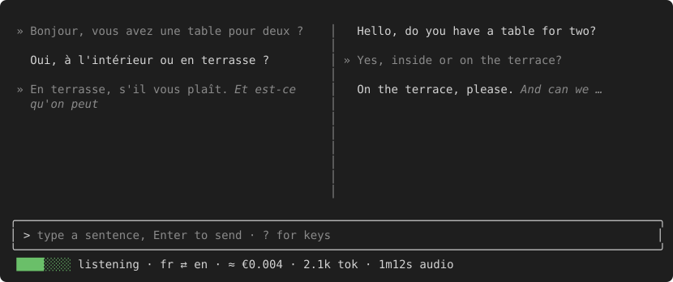

# duetty

[](https://github.com/nlm/duetty/actions/workflows/ci.yml)

**Live two-language transcripts for face-to-face conversations, in your terminal.**

Two people who don't share a language sit in front of one laptop and talk.
duetty listens, writes down what each person says in their own language, and
shows the translation next to it. Nobody waits for a voice to read the
translation aloud. Each person just reads the other's words.

The name is *duet* + *tty*: two voices in conversation, in a terminal.



<!-- Regenerate the picture: DUETTY_WRITE_SVG=1 go test ./internal/ui -run TestWriteREADMEScreenshot -->

## Features

- **Two panes, one per language.** Each sentence appears in the pane of the
  language it was spoken in, marked with `»`, and its translation appears
  level with it in the other pane.
- **Live preview.** Text and its translation appear while the person is
  still speaking. Finished sentences are fixed before the speaker stops.
- **Speech or keyboard.** Speak into the microphone or type a sentence.
  `-mic off` gives you a text-only translator.
- **Reliable language pick.** Whisper's language guess is checked against
  your two languages and against the text itself. If it looks wrong, duetty
  transcribes the audio again in each of your languages.
- **Noise rejection.** Coughs, clicks and background chatter are filtered
  out before and after transcription.
- **Cost counter.** The status bar counts tokens and audio seconds for the
  session. Add your prices and it shows a cost estimate too.
- **Private by default.** No audio or text is written to disk, and the
  optional log holds only timings and errors.
- **Works with any OpenAI-compatible API.** Tested with Scaleway Generative
  APIs (`whisper-large-v3` and `mistral-small-3.2`).

## Quick start

Download the archive for your platform from the
[releases page](https://github.com/nlm/duetty/releases), then:

```sh
tar xzf duetty-*-linux-amd64.tar.gz && cd duetty-*-linux-amd64

export DUETTY_API_URL=https://api.scaleway.ai/<project_id>/v1
export DUETTY_API_KEY=...            # your provider's API key
./duetty -languages fr,en
```

Speak, or type a sentence and press Enter. Press `?` to see the keys and
`Ctrl+C` to quit.

No API account? duetty also runs fully offline with a local Whisper server
and Ollama: see [Running duetty offline](docs/offline.md).

## Installation

### Release archives

Each [release](https://github.com/nlm/duetty/releases) has a self-contained
archive for Linux x86-64, Linux arm64 and macOS on Apple silicon: the
`duetty` binary with its models, the onnxruntime library and their licenses.
Unpack it anywhere and keep the files together; duetty finds its models next
to the binary. A `.sha256` file is published next to each archive.

- **Linux:** needs the ALSA library (`libasound2`), present on desktop
  distributions.
- **macOS:** the binary is not signed. If macOS refuses to open it, run
  `xattr -dr com.apple.quarantine .` in the unpacked folder. Allow your
  terminal to use the microphone when asked.

### From source

Requirements:

- Go 1.26 with cgo enabled (a C compiler)
- Linux (x86-64 or arm64) with the ALSA development headers
  (`libasound2-dev`), or macOS on Apple silicon
- `curl` for the setup scripts

```sh
git clone https://github.com/nlm/duetty.git && cd duetty
scripts/setup-models.sh            # Silero VAD, Smart Turn, onnxruntime
scripts/setup-denoise.sh           # optional: GTCRN denoiser for -denoise
go build -o duetty ./cmd/duetty    # build in the repo root
```

duetty looks for `models/` and `third_party/onnxruntime/` **next to the
`duetty` binary only**, never in the current directory. Build into the repo
root as shown above. If the binary lives elsewhere (for example with
`go run`), pass `-vad-model`, `-smart-turn-model`, `-onnxruntime-lib` and
`-denoise-model` explicitly.

Typed input (`-mic off`) needs none of the models.

### API

duetty needs an OpenAI-compatible API with a speech-to-text model (Whisper)
and a chat model: a cloud provider such as Scaleway Generative APIs, or local
servers ([offline guide](docs/offline.md)).

## Usage

```sh
duetty -languages fr,en                  # French on the left, English on the right
duetty -languages fr,en -mic off         # typed input only; no audio models loaded
duetty -languages fr,en -timestamps      # show times next to sentences
duetty -languages fr,en -denoise         # local noise suppression
duetty -languages fr,en -live-preview=false   # one transcription per turn (cheaper)
duetty -languages fr,en -log-file duetty.log    # timings and errors, never text
```

`-languages` (or `-langs`) takes two Whisper language codes, left pane
first. Run `duetty -h` for every flag.

### Keys

| Key | Action |
|-----|--------|
| `Enter` | Send the typed sentence |
| `Esc` | Cancel the translation in progress (the cancelled sentence stays, greyed out). With live preview on, also drop the sentence being spoken. Sentences already fixed stay. |
| `Ctrl+P` | Mute or unmute the microphone |
| `PgUp` / `PgDn`, mouse wheel | Scroll both panes |
| `?` | Help (when the input is empty) |
| `Ctrl+C` | Quit |

## Configuration

Put settings in `~/.config/duetty/config.toml`. A file elsewhere is read only
when you name it with `-config`. Flags override the file, and the file
overrides the environment.

```toml
api_url   = "https://api.scaleway.ai/<project_id>/v1"
languages = ["fr", "en"]
```

| Setting | Where | Default |
|---------|-------|---------|
| API endpoint | `api_url`, `-api-url`, or env `DUETTY_API_URL` (`OPENAI_BASE_URL`) | none, required |
| Separate endpoints | `stt_api_url`, `translate_api_url` (e.g. local servers) | `api_url` |
| API key | env `DUETTY_API_KEY` (`OPENAI_API_KEY`), or `api_key` | none, required |
| Languages | `languages`, `-languages` | `fr`, `en` |
| Models | `stt_model`, `translate_model` | `whisper-large-v3`, `mistral-small-3.2-24b-instruct-2506` |
| Microphone | `mic`, `-mic` | system default; `off` for typed input only |
| Live preview | `live_preview`, `-live-preview` | `true` |

The endpoint has no default, so your key only ever goes to a provider you
chose, and it must use `https`. Keep the key in the environment and never
commit a file that contains one.

Everything else (voice detection, end of turn, noise filters, prices) is
listed with its default and meaning in
[`config.example.toml`](config.example.toml).

### Live preview and cost

Live preview works by sending the growing recording to Whisper about once a
second. Transcription cost rises to roughly 4× the audio length at most.
Turn it off with `live_preview = false` to get one transcription per turn.

The status bar always shows a session counter, such as
`18.3k tok · 4m10s audio`. A cost estimate (`≈ €0.042 · …`) is added only
when all three `price_*` keys are set. duetty ships no default prices;
`config.example.toml` lists Scaleway's figures for reference.

## How it works

```
mic ─▶ Silero VAD ─▶ Smart Turn ─▶ Whisper ─▶ language check ─▶ translation ─▶ panes
          voice        end of turn    text       pair + text      chat model
```

1. **Voice activity.** Silero VAD finds speech. Sounds shorter than 250 ms
   are dropped, and the silent edges of the audio are trimmed.
2. **End of turn.** Smart Turn decides when the speaker has finished, so a
   pause in the middle of a sentence does not cut it.
3. **Transcription.** The audio goes to Whisper, which auto-detects the
   language. duetty checks that the language is one of your two and that the
   text matches it. If not, it transcribes again in each of your languages
   and keeps the better result. Low-confidence results are dropped as noise.
4. **Translation.** A chat model translates each sentence, using the last
   few sentences as context.
5. **Live preview.** While the turn is still going, duetty re-sends the
   recording and shows the provisional text. When Whisper's output shows
   that a sentence is finished and a new one has started, that sentence is
   fixed and translated for good.

## Privacy

- No audio or conversation text is written to disk.
- The log file (`-log-file`) records timings, states and errors only. It
  never contains conversation text or your API key.
- `./config.toml` is never loaded automatically, so a file in some directory
  cannot redirect your key to another server.
- The API endpoint must use `https` (except for localhost).

## Evaluation

`duetty-eval` runs recorded clips through the same pipeline as the app and
reports language-pick accuracy and noise rejection against your API.

```sh
go build -o duetty-eval ./cmd/duetty-eval
scripts/fetch-tatoeba-clips.sh fr,en,es,ja 10 eval/clips   # needs curl, ffmpeg, python3
DUETTY_API_KEY=... ./duetty-eval -config my.toml -clips eval/clips/meta.json
```

With `whisper-large-v3`, duetty picked the right language for 20/20 clips on
each of the six pairs tested, and rejected all 25 noise clips without losing
any short real word. Audio clips are not committed because Tatoeba licenses
vary; only the fetch script is. See [`eval/README.md`](eval/README.md) for
details.

## Development

```sh
go test -race ./...
go vet ./...
```

| Path | Contents |
|------|----------|
| `cmd/duetty` | The app |
| `cmd/duetty-eval` | The evaluation tool |
| `internal/vad`, `internal/silerovad`, `internal/smartturn` | Microphone capture, voice activity, end of turn |
| `internal/stt` | Whisper client and language resolution |
| `internal/translate` | Translation client |
| `internal/live` | Live preview: refresh pacing and sentence commits |
| `internal/convo` | The conversation log shown on screen |
| `internal/ui` | Terminal interface (tview) |
| `internal/usage` | Token and audio counter |
| `docs/superpowers/specs` | Design documents |

The README picture is rendered from the real UI code:
`DUETTY_WRITE_SVG=1 go test ./internal/ui -run TestWriteREADMEScreenshot`.

CI runs gofmt, `go vet` and the tests (including the model-backed ones) on
Linux and macOS for every push and pull request.

To release, push a version tag:

```sh
git tag v0.1.0 && git push origin v0.1.0
```

The release workflow builds the archives with `scripts/package-release.sh`
on each platform and publishes them as a GitHub release.

## Known limitations

- The macOS build has not been tried on a real Mac yet; CI only builds and
  tests it.
- The denoiser has not been tested in a noisy café.
- If both people speak inside one sentence that never splits, the text stays
  mixed until the end of the turn.
- On Linux, ALSA may print warnings before the interface starts. Hide them
  with `2>/dev/null`.

## Acknowledgements

- [Silero VAD](https://github.com/snakers4/silero-vad) for voice activity
  detection
- [Smart Turn](https://github.com/pipecat-ai/smart-turn) for end-of-turn
  detection
- [GTCRN](https://github.com/Xiaobin-Rong/gtcrn) for denoising
- [Whisper](https://github.com/openai/whisper) for speech-to-text
- [Lingua](https://github.com/pemistahl/lingua-go) for checking the text's language
- [tview](https://github.com/rivo/tview), [malgo](https://github.com/gen2brain/malgo)
  and [onnxruntime_go](https://github.com/yalue/onnxruntime_go)
- [Tatoeba](https://tatoeba.org) for the evaluation clips

## License

duetty is licensed under the [Apache License 2.0](LICENSE).
